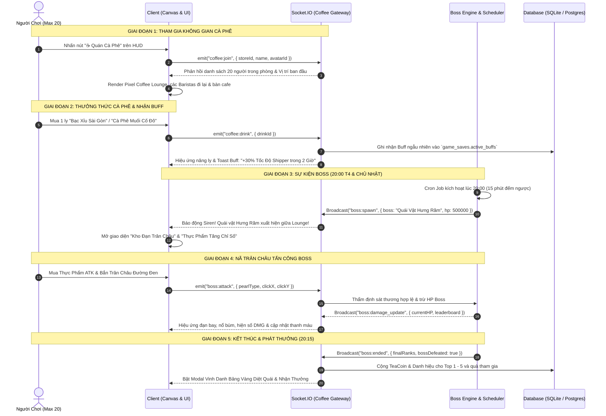

# ☕ BẢN ĐỒ CHIẾN LƯỢC: KHÔNG GIAN CÀ PHÊ MULTIPLAYER & ĐẠI CHIẾN BOSS HƯNG RĂM
## Dự Án: Tiệm Trà Sữa HeeHee (Coffee Lounge Multiplayer & World Boss Battle System)

---

> **Tóm tắt tính năng:** Mở rộng không gian trò chơi với **Bản Đồ Quán Cà Phê Đa Người Chơi (Coffee Lounge Map)** hỗ trợ tối đa **20 Baristas cùng tham gia phòng trực tuyến theo thời gian thực (Socket.IO)**. Tại đây, người chơi có thể thưởng thức các dòng cà phê thủ công để nhận **Buff chỉ số ngẫu nhiên cho Tiệm Trà Sữa**. Đặc biệt, vào **20:00 tối Thứ Tư & Chủ Nhật hàng tuần**, quán cà phê sẽ kích hoạt sự kiện săn Boss thế giới kéo dài **15 phút**: Đại chiến **Quái Vật Bạch Tuộc Hưng Răm** (Model NPC #52). Người chơi sẽ trang bị thực phẩm tăng công/thủ và mua các loại **Trân Châu Chiến Đấu** để nã đạn về phía Boss, tranh đua bảng xếp hạng sát thương Top 1 - 5 giành **TeaCoin**, danh hiệu và vật phẩm huyền thoại!

---

```
╔════════════════════════════════════════════════════════════════════════════════════════════════════╗
║                   CÁC TRỤ CỘT TÍNH NĂNG CHÍNH: COFFEE LOUNGE & BOSS HƯNG RĂM                       ║
║                                                                                                    ║
║  ☕ 1. COFFEE LOUNGE MULTIPLAYER: Phòng ảo 20 người chơi cùng di chuyển, tán gẫu, giao lưu real-time ║
║  🎲 2. COFFEE BUFF SYSTEM: 6 món cà phê thủ công ban tặng Random Buff cực mạnh cho Tiệm Trà Sữa   ║
║  ⏰ 3. LỊCH SỰ KIỆN BOSS: Đúng 20:00 - 20:15 (15 Phút) vào mỗi TỐI THỨ TƯ & CHỦ NHẬT hàng tuần     ║
║  🥐 4. THỰC PHẨM CHIẾN TRANH: Bổ sung món ăn tăng Tấn Công (ATK), Phòng Thủ (DEF), Tốc Bắn (ATK SPD) ║
║  🧋 5. ĐẠN TRÂN CHÂU CHIẾN ĐẤU: 5 loại đạn trân châu độc lạ nã đạn tiêu hao máu Quái Vật Hưng Răm  ║
║  🏆 6. BXH SÁT THƯƠNG & PHẦN THƯỞNG: Vinh danh Top 1 - 5 nhận TeaCoin, Danh hiệu độc quyền & Quà xịn║
╚════════════════════════════════════════════════════════════════════════════════════════════════════╝
```

---

## 🧭 I. KIẾN TRÚC TỔNG THỂ & QUY TRÌNH HOẠT ĐỘNG (SYSTEM ARCHITECTURE)



---

## ☕ II. BẢN ĐỒ KHÔNG GIAN CÀ PHÊ MULTIPLAYER (COFFEE LOUNGE MAP)

### 1. Thông Số Không Gian & Cơ Chế Phòng
- **Quy mô phòng:** Tối đa **20 Baristas / 1 Room** (Tự động mở Room mới `Lounge-01`, `Lounge-02` khi đầy).
- **Kích thước Map Pixel:** $960 \times 540$ logical pixels (Tỉ lệ chuẩn 16:9 sắc nét, hỗ trợ co giãn Responsive trên mobile & PC).
- **Phân khu chức năng:**
  1. **Quầy Espresso Bar (Trung tâm trên):** Nơi máy pha cà phê La Marzocco cổ điển nhả khói, Barista NPC phục vụ order.
  2. **Bàn Tròn Gỗ Sồi (Khu vực trung tâm):** Nơi các người chơi ngồi xuống uống cà phê, hiển thị biểu tượng ly cà phê bốc khói trên đầu.
  3. **Ban Công Ngắm Phố Hoàng Hôn (Bên phải):** Góc chill ngắm mưa rơi, chụp ảnh kỷ niệm cùng đồng nghiệp.
  4. **Khu Vực Bệ Triệu Hồi Vũ Trụ (Trung tâm map):** Bệ đá ma thuật phát sáng tím neon — nơi Quái Vật Hưng Răm sẽ trồi lên lúc 20:00!
- **Tương tác người chơi:**
  - Di chuyển bằng phím $W-A-S-D$, phím mũi tên hoặc chạm/click chuột vào điểm đến (Touch to Walk).
  - Tích hợp **Chat Bong Bóng Trực Quan (Speech Bubbles)** hiển thị ngay trên đầu nhân vật.
  - Các tương tác cảm xúc: Vẫy tay 👋, Nâng ly ☕, Nhảy múa 💃, Thả tim ❤️.

---

## 🎲 III. HỆ THỐNG ĐỒ UỐNG CÀ PHÊ & HIỆU ỨNG RANDOM BUFF CHO QUÁN

Mỗi ngày, người chơi được thưởng thức tối đa **3 ly cà phê**. Khi uống, nhân vật sẽ nhấp từng ngụm, kèm hiệu ứng hào quang sáng rực và **kích hoạt ngẫu nhiên 1 trong các Buff chỉ số quý hiếm** kéo dài trong **60 - 120 phút** tại Tiệm Trà Sữa chính:

| Tên Món Cà Phê | Mô Tả Pixel Hương Vị | Giá Bán (Tiền/TeaCoin) | Chỉ Số Random Buff Có Thể Nhận | Tỉ Lệ Xuất Hiện |
| :--- | :--- | :---: | :--- | :---: |
| ☕ **Cà Phê Phin Sữa Đá Đậm Vị** | Hạt Robusta Buôn Ma Thuột nhỏ từng giọt qua phin nhôm, quyện sữa đặc béo ngậy. | 15.000đ | **Tỉnh Táo Xuyên Ca:** Tăng +35% tốc độ phục vụ & dập nắp ly trong 90 phút. | 30% |
| 🥛 **Bạc Xỉu Ba Tầng Sài Gòn** | Lớp sữa đặc trắng muốt, sữa tươi béo ngậy và lớp bọt cà phê nâu sóng sánh. | 18.000đ | **Hút Khách Gen Z:** Tăng +40% tỉ lệ xuất hiện Học Sinh & Sinh Viên tip thêm tiền. | 25% |
| 🧂 **Cà Phê Muối Cố Đô Huế** | Lớp kem mặn bồng bềnh phủ trên nền cà phê đen sóng sánh, hậu vị mặn mà khó quên. | 22.000đ | **Mặn Mà Doanh Thu:** Mọi ly trà sữa bán ra được cộng thêm +25% giá tiền trong 60 phút. | 20% |
| 🍊 **Cold Brew Cam Sả Thanh Mát** | Cà phê Arabica Cầu Đất ủ lạnh 16 tiếng cùng lát cam vàng mọng nước và sả đập dập. | 25.000đ | **Chiến Thần Tốc Độ:** Tăng tốc độ xe Wave của Anh Lâm Shipper gấp đôi (x2 Speed). | 15% |
| 🍳 **Cà Phê Trứng Khò Phố Cổ** | Lòng đỏ trứng gà đánh bông mịn màng như mây, khò lửa caramel thơm nức mũi. | 30.000đ | **Hào Quang 5 Sao:** Danh tiếng quán được khóa cứng ở mức tối đa 5.0⭐, không bị tụt. | 8% |
| 👑 **Espresso Trầm Hương Hoàng Gia** | Chiết xuất áp suất cao từ hạt Geisha quý hiếm, nhỏ giọt qua lớp gỗ trầm hương ngát thơm. | 2 TeaCoin | **Vận May Đại Cát:** Đơn hàng tiếp theo có 50% tỉ lệ nổ "Đơn Hàng Doanh Nghiệp x10 Ly"! | 2% |

---

## 🐙 IV. ĐẠI CHIẾN WORLD BOSS: QUÁI VẬT HƯNG RĂM (#52)

### 1. Thời Gian & Điều Kiện Kích Hoạt Sự Kiện
- **Lịch diễn ra cố định:** Đúng **20h00 tối Thứ Tư** và **20h00 tối Chủ Nhật** hàng tuần.
- **Thời lượng trận chiến:** Đúng **15 Phút** (Từ 20:00:00 đến 20:15:00).
- **Cơ chế phòng thủ:** Hệ thống tự động đếm ngược thông báo trước 15 phút trên HUD toàn server (`19:45`).
- **Địa điểm giao chiến:** Ngay tại sảnh trung tâm của **Coffee Lounge**.

### 2. Thông Số & Đặc Trưng Boss "Quái Vật Hưng Răm"
- **Nhân vật gốc:** ID #52 trong `ModelNPC.html` (`hung_ram_monster`).
- **Hình tượng Pixel Art:**
  - Bạch tuộc vũ trụ xúc tua tím neon (`#9333EA`) phát sáng kỳ ảo du hành từ đại dương thiên hà.
  - Đội **nón lá Việt Nam cute** (`#FDE047`), đeo **kính mát râm ngầu lòi** (`#0F172A`).
  - Miệng cười răng khểnh tinh nghịch, 8 xúc tua nhảy múa cầm theo ly Boba khổng lồ đòi cướp toàn bộ quầy bar của Chị Thảo!
- **Chỉ số Boss:**
  - **Máu cơ bản (Max HP):** $HP = 200.000 \times \text{Số người chơi trong phòng}$ (Ví dụ 20 người = $4.000.000$ HP).
  - **Giáp cơ bản (Armor):** $15\%$ giảm sát thương đạn thông thường.
- **Các Giai Đoạn Chiến Đấu (Boss Phases):**
  - **Phase 1: Quẩy Xúc Tu Săn Boba ($100\% \rightarrow 60\%$ HP):** Boss nhảy múa, bắn ra các bong bóng mực ngọt ngào.
  - **Phase 2: Kính Râm Phát Sáng ($60\% \rightarrow 25\%$ HP):** Kính mát đổi màu đỏ rực, tung chiêu *Xúc Tu Cuồng Nộ* hất văng trân châu bay lệch hướng $20^\circ$.
  - **Phase 3: Cơn Thịnh Nộ Đòi Uống Oolong ($25\% \rightarrow 0\%$ HP):** Boss xoay tròn nón lá, kích hoạt lá chắn bọt biển tăng $50\%$ tốc độ quẫy — Cần toàn bộ 20 người chơi dồn hỏa lực tổng lực!

---

## 🥐 V. THỰC PHẨM TIẾP SỨC CHIẾN TRANH (EVENT FOOD BUFFS)

Vào các ngày diễn ra sự kiện (Thứ Tư & Chủ Nhật), Quán Cà Phê mở quầy **Bếp Nướng Tiếp Sức** để người chơi nạp năng lượng trước và trong trận đánh:

| Món Ăn Tiếp Sức | Giá Bán | Hiệu Ứng Chiến Đấu | Thời Gian Tác Dụng |
| :--- | :---: | :--- | :---: |
| 🥖 **Bánh Mì Pate Cay Xè Lưỡi** | 5.000đ | **+25% Sát Thương Tấn Công (ATK)** cho mọi loại trân châu bắn ra. | 15 Phút |
| 🍰 **Tiramisu Cacao Đậm Đặc** | 10.000đ | **+30% Tỉ Lệ Bạo Kích (Crit Rate)** & Sát thương Crit tăng lên $\times 2.0$. | 15 Phút |
| 🥪 **Sandwich Phô Mai Nướng Giòn** | 8.000đ | **Giảm 50% Thời Gian Nạp Đạn** (Tốc độ nã trân châu tăng gấp đôi). | 15 Phút |
| 🥗 **Salad Bơ Trứng Hồi Phục** | 6.000đ | **Kháng Mực Bạch Tuộc:** Đạn trân châu không bị chệch hướng khi Boss cuồng nộ. | 15 Phút |
| 🍖 **Bò Bít Tết Sốt Tiêu Thượng Hạng** | 1 TeaCoin | **Chiến Binh Toàn Năng:** $+40\%$ ATK, $+30\%$ Crit, đạn bắn ra có hiệu ứng hào quang vàng! | Toàn bộ trận đấu |

---

## 🧋 VI. VŨ KHÍ TẤN CÔNG: CÁC LOẠI ĐẠN TRÂN CHÂU CHIẾN ĐẤU

Người chơi mua các loại đạn trân châu bằng Tiền Vàng hoặc TeaCoin từ **Băng Đạn Shaker Chiến Thuật**:

```
        ┌────────────────────────────────────────────────────────────┐
        │        BĂNG ĐẠN TRÂN CHÂU BẮN QUÁI VẬT HƯNG RĂM            │
        ├────────────────────────────────────────────────────────────┤
        │  [1] Trân Châu Đen Cơ Bản       • 500đ/10 viên   • DMG: 150│
        │  [2] Trân Châu Đường Đen Lửa    • 2.000đ/10 viên • DMG: 380│
        │  [3] Trân Châu Hoàng Kim Crit   • 5.000đ/10 viên • DMG: 750│
        │  [4] Trân Châu Băng Mộc Châu    • 8.000đ/10 viên • ĐÓNG BĂNG│
        │  [5] Trân Châu Nổ Vũ Trụ        • 1 TeaCoin/băng • DMG:2500│
        └────────────────────────────────────────────────────────────┘
```

### Chi Tiết Chỉ Số Đạn:
1. **Trân Châu Đen Dẻo Dai (Basic Pearl):**
   - Giá: $500$đ / Băng 10 viên.
   - Sát thương: $120 - 180$ DMG/viên.
   - Đặc điểm: Tốc độ bay nhanh, chi phí rẻ, thích hợp tân thủ cày sát thương liên tục.
2. **Trân Châu Đường Đen Nấu Nồi Đất (Flame Pearl):**
   - Giá: $2.000$đ / Băng 10 viên.
   - Sát thương: $350 - 450$ DMG/viên.
   - Kèm hiệu ứng: **Thiêu đốt mật mía** gây thêm $80$ DMG mỗi giây kéo dài 3 giây.
3. **Trân Châu Hoàng Kim Phủ Vàng (Golden Crit Pearl):**
   - Giá: $5.000$đ / Băng 10 viên.
   - Sát thương: $650 - 900$ DMG/viên.
   - Kèm hiệu ứng: $45\%$ cơ hội nảy Bạo Kích vàng rực $\times 2.5$ Sát thương ($2.000+$ DMG).
4. **Trân Châu Băng Tuyết Mộc Châu (Frost Pearl):**
   - Giá: $8.000$đ / Băng 5 viên.
   - Sát thương: $400$ DMG/viên.
   - Kèm hiệu ứng: Làm chậm xúc tu Boss $40\%$ trong 4 giây. Nếu 10 viên bắn trúng cùng lúc, Boss bị **Đóng Băng Tê Liệt** trong 2 giây!
5. **Trân Châu Nổ Thiên Hà Vũ Trụ (Cosmic Burst Boba):**
   - Giá: **1 TeaCoin** / Hộp 15 viên.
   - Sát thương: $2.200 - 3.000$ DMG/viên.
   - Kèm hiệu ứng: Nổ tung chùm sao neon tím, gây sát thương diện rộng phá vỡ lá chắn của Hưng Răm ngay tức khắc!

---

## 🏆 VII. BẢNG XẾP HẠNG SÁT THƯƠNG & CƠ CẤU PHẦN THƯỞNG

Khi đồng hồ điểm **20:15:00** hoặc khi **HP Boss tụt về 0**, trận đấu lập tức khép lại. Hệ thống căn cứ vào tổng điểm sát thương (Total DMG Dealt) của từng người chơi để trao thưởng trực tiếp vào ví:

| Thứ Hạng Sát Thương | Phần Thưởng TeaCoin | Danh Hiệu Độc Quyền (Title) | Vật Phẩm Quý Kèm Theo |
| :---: | :---: | :--- | :--- |
| 🥇 **HẠNG 1 (MVP)** | **50 TeaCoin** | 👑 **Chiến Thần Đập Răm** *(Hào quang tím phát sáng trên đầu)* | • Skin Xe Đẩy: **Cỗ Xe Cà Phê Vũ Trụ Pixel**<br>• 10 Thẻ Miễn Phí Thuê NPC 24h<br>• $5.000.000$đ Tiền Mặt Quán |
| 🥈 **HẠNG 2** | **35 TeaCoin** | 🥈 **Đại Kiện Tướng Trân Châu** | • 5 Thùng Hạt Cà Phê Geisha Hoàng Gia<br>• $3.000.000$đ Tiền Mặt Quán |
| 🥉 **HẠNG 3** | **25 TeaCoin** | 🥉 **Xạ Thủ Xúc Tu Khét Tiếng** | • 3 Thùng Hạt Cà Phê Cầu Đất<br>• $2.000.000$đ Tiền Mặt Quán |
| 🏅 **HẠNG 4** | **15 TeaCoin** | 🎖️ **Dũng Sĩ Cafe Cà Pháo** | • 2 Thẻ Giảm 50% Tiền Thuê Mặt Bằng<br>• $1.000.000$đ Tiền Mặt Quán |
| 🏅 **HẠNG 5** | **10 TeaCoin** | 🎖️ **Dũng Sĩ Cafe Cà Pháo** | • 1 Thẻ Giảm 50% Tiền Thuê Mặt Bằng<br>• $500.000$đ Tiền Mặt Quán |
| 🎁 **TOP 6 - 20 & Tham Gia** | **5 TeaCoin** | ☕ **Cư Dân Quán Ghiền Boba** | • Hộp Quà Lưu Niệm Quán Cà Phê (Random nguyên liệu hiếm)<br>• $200.000$đ Quỹ Quán |

---

## 💻 VIII. ĐẶC TẢ KỸ THUẬT & DATABASE SCHEMA

### 1. Database Schema Mới
Bổ sung các bảng dữ liệu chuyên biệt vào hệ thống:

```sql
-- 1. Bảng lưu trữ trạng thái phiên sự kiện Boss
CREATE TABLE IF NOT EXISTS boss_events (
  id TEXT PRIMARY KEY,
  event_date TEXT NOT NULL,           -- Ví dụ: '2026-10-14'
  day_of_week INTEGER NOT NULL,       -- 3: Thứ Tư, 0: Chủ Nhật
  start_time BIGINT NOT NULL,         -- 20:00:00 timestamp
  end_time BIGINT NOT NULL,           -- 20:15:00 timestamp
  boss_type TEXT DEFAULT 'hung_ram_monster',
  max_hp BIGINT NOT NULL,
  current_hp BIGINT NOT NULL,
  is_defeated INTEGER DEFAULT 0,
  created_at TEXT NOT NULL
);

-- 2. Bảng ghi nhận sát thương của từng người chơi
CREATE TABLE IF NOT EXISTS boss_damage_logs (
  id SERIAL PRIMARY KEY,
  event_id TEXT REFERENCES boss_events(id) ON DELETE CASCADE,
  store_id INTEGER REFERENCES stores(id) ON DELETE CASCADE,
  player_name TEXT NOT NULL,
  total_damage BIGINT DEFAULT 0,
  pearls_shot INTEGER DEFAULT 0,
  crit_hits INTEGER DEFAULT 0,
  rank_position INTEGER DEFAULT 0,
  reward_claimed INTEGER DEFAULT 0,
  updated_at TEXT NOT NULL,
  UNIQUE(event_id, store_id)
);

-- 3. Bổ sung trường dữ liệu Coffee Buffs vào bảng game_saves
-- ALTER TABLE game_saves ADD COLUMN IF NOT EXISTS coffee_buffs TEXT DEFAULT '{}';
-- ALTER TABLE game_saves ADD COLUMN IF NOT EXISTS coffee_daily_cups INTEGER DEFAULT 0;
```

### 2. Socket.IO Gateway Events
- **Client $\rightarrow$ Server:**
  - `coffee:join_room`: Gửi `{ storeId, storeName, avatarId }` để xin vào Lounge (kiểm tra room $< 20$).
  - `coffee:move`: Gửi `{ x, y, state, direction }` đồng bộ tọa độ nhân vật bước đi.
  - `coffee:chat`: Gửi `{ message }` để hiện Speech Bubble.
  - `coffee:drink`: Gửi `{ coffeeId }` để uống cà phê và quay thưởng Buff.
  - `boss:shoot`: Gửi `{ pearlType, targetX, targetY, timestamp }` để nã đạn trân châu.
  - `boss:eat_food`: Gửi `{ foodId }` kích hoạt buff ăn uống.
- **Server $\rightarrow$ Client (Broadcast):**
  - `coffee:room_state`: Danh sách toàn bộ người chơi hiện diện, vị trí, động tác.
  - `coffee:player_joined` / `coffee:player_left`: Thông báo ra vào sảnh.
  - `boss:countdown`: Thông báo thời gian đếm ngược trước khi Boss xuất hiện.
  - `boss:state_update`: Cập nhật `%` máu Boss, Phase hiện tại, đòn đánh xúc tu.
  - `boss:leaderboard_live`: Top 5 sát thương cập nhật mỗi 1.5 giây.
  - `boss:victory_or_timeout`: Kết thúc trận chiến, hiển thị kết quả và phát thưởng.

---

## 🎨 IX. BẢN VẼ PIXEL ART & GIAO DIỆN CHIẾN TRẬN (UI/UX WIREFRAME)

```
╔═══════════════════════════════════════════════════════════════════════════════════════════════╗
║ [☕ QUÁN CÀ PHÊ HEEHEE - PHÒNG #01 (18/20 BẠN BÈ)]                    [⏰ BOSS: 09:42 / 15:00]║
╠═══════════════════════════════════════════════════════════════════════════════════════════════╣
║  [BAR BOSS HP] [████████████████████████░░░░░░░░░░░░░░░░░░] 58.4% (2.336.000 / 4.000.000 HP) ║
║                                                                                               ║
║                                  /\_/\    [Nón Lá Cute]                                       ║
║                                 ( o.o )   [Kính Mát Râm]                                      ║
║                                / >🧋 < \  [QUÁI VẬT HƯNG RĂM]                                 ║
║                               ~~~~~~~~~~~~~~~~~ (8 Xúc Tu Neon)                               ║
║                                                                                               ║
║      💥 -1.850 (CRIT!)          💥 -420            💥 -2.500 (COSMIC!)                        ║
║            ●                      ●                      ●                                    ║
║           / \                    / \                    / \                                   ║
║        [HeeHee]              [Bé Bắp]               [Anh Lâm]                                 ║
║      "Bắn trân châu!"      "Nạp pate nào!"       "Wave chiến nã!"                             ║
║                                                                                               ║
╠═══════════════════════════════════════════════════════════════════════════════════════════════╣
║ 🏆 BXH SÁT THƯƠNG LIVE:                      │ 🧋 KHO ĐẠN TRÂN CHÂU:                           ║
║ #1. Tiệm HeeHee Flagship: 542.000 DMG (👑)   │ [1] Đen: x40  [2] Đường Đen: x18               ║
║ #2. Boba King Sài Gòn:    489.100 DMG        │ [3] Hoàng Kim: x8 [4] Vũ Trụ: x3               ║
║ #3. Trà Sữa Trâu Vàng:    310.500 DMG        ├────────────────────────────────────────────────┤
║ #4. Anh Lâm Hỏa Tốc:      280.400 DMG        │ 🥐 BUFF HIỆN TẠI: 🥖 +25% ATK | 🥪 +50% Tốc Bắn ║
║ #5. Bé Bắp Siêu Tốc:      215.000 DMG        │ 👉 CLICK / CHẠM VÀO BOSS ĐỂ NÃ ĐẠN TRÂN CHÂU!  ║
╚═══════════════════════════════════════════════════════════════════════════════════════════════╝
```

---

## 📅 X. LỘ TRÌNH TRIỂN KHAI THEO GIAI ĐOẠN (IMPLEMENTATION ROADMAP)

```mermaid
gantt
    title Lộ Trình Phát Triển Tính Năng Coffee Lounge & World Boss Hưng Răm
    dateFormat  YYYY-MM-DD
    section Giai Đoạn 1: Core Map & Sync
    Thiết kế Pixel Art Map Coffee Lounge & Assets    :2026-10-12, 3d
    Dựng Socket.IO Gateway & Quản lý Room 20 người  :2026-10-14, 3d
    Cơ chế di chuyển, tán gẫu & Chat Bubble         :2026-10-16, 2d
    section Giai Đoạn 2: Coffee & Buffs
    Menu 6 món cà phê & Hệ thống Random Buff Quán   :2026-10-18, 3d
    Animation nhấp cà phê & Hào quang nhân vật      :2026-10-20, 2d
    section Giai Đoạn 3: Boss Battle Engine
    Scheduler Tự Động 20:00 T4 & CN (15 Phút)       :2026-10-22, 2d
    Tích hợp Model Quái Vật Hưng Răm & Animation HP :2026-10-23, 3d
    Cơ chế Bắn Trân Châu, Đạn Dược & Thực Phẩm ATK  :2026-10-25, 3d
    section Giai Đoạn 4: Leaderboard & Polish
    BXH Live, Trao Thưởng TeaCoin & Danh Hiệu       :2026-10-27, 2d
    Âm thanh Web Audio SFX (Đạn bay, nổ, nhạc boss) :2026-10-28, 2d
    Kiểm thử Tải 20 Sockets đồng thời & Đóng gói    :2026-10-29, 2d
```

---

## 🎯 TỔNG KẾT
File tài liệu này định nghĩa trọn vẹn và hoàn chỉnh từ **Ý tưởng Game Design**, **Mô hình Dữ liệu**, **Quy tắc Tính Điểm/Sát Thương**, **Giao diện Pixel Art** cho đến **Cơ chế WebSocket Thời Gian Thực** cho tính năng **Cà Phê Multiplayer & Boss Thế Giới Hưng Răm**. Sẵn sàng làm kim chỉ nam để bắt tay triển khai mã nguồn chi tiết!

