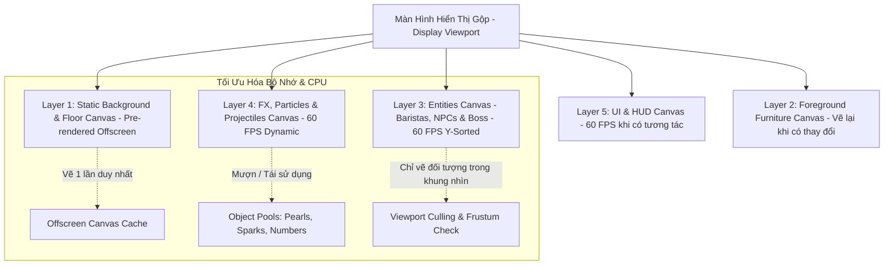

# 🎨 BẢN ĐỒ CHIẾN LƯỢC: TỐI ƯU ĐỒ HỌA, MƯỢT MÀ 60 FPS & TĂNG CƯỜNG CHI TIẾT MAP CÀ PHÊ
## Dự Án: Tiệm Trà Sữa HeeHee (Coffee Lounge High-Fidelity Pixel Graphics & Performance Roadmap)

---

> **Mục tiêu kỹ thuật & mỹ thuật:** Định nghĩa chi tiết toàn bộ giải pháp **Tối ưu hóa hiệu năng render 60 FPS mượt mà**, đồng thời **Nâng cấp độ chi tiết đồ họa Retro Pixel Art sắc nét** cho toàn bộ **Bản đồ Quán Cà Phê Đa Người Chơi (Coffee Lounge Map)**. Hướng dẫn bao gồm kiến trúc **Multi-Layer Canvas Rendering**, **Object Pooling**, hệ thống chi tiết **Bối Cảnh Quán Cà Phê Ấm Cúng**, hoạt ảnh sống động cho **Nhân Vật Baristas (20 Người chơi đồng bộ)**, hệ sinh thái **NPC Quán Cà Phê** và tối ưu hóa hiệu ứng hoành tráng trong trận chiến **World Boss Quái Vật Hưng Răm**.

---

```
╔════════════════════════════════════════════════════════════════════════════════════════════════════╗
║                   CÁC TRỤ CỘT TỐI ƯU ĐỒ HỌA & NÂNG CẤP CHI TIẾT MAP CÀ PHÊ                         ║
║                                                                                                    ║
║  ⚡ 1. HIỆU NĂNG 60 FPS & KHÔNG GIẬT LAG: Multi-Layer Canvas, Offscreen Blitting, Viewport Culling║
║  ♻️ 2. QUẢN LÝ BỘ NHỚ ZERO-GC: Object Pooling cho Đạn Trân Châu, Hạt Khói, Số Sát Thương DMG Pop-up║
║  ☕ 3. BỐI CẢNH COZY VINTAGE CAFE CHI TIẾT: Máy La Marzocco đồng thau, Quầy gỗ sồi, Đèn Edison ấm  ║
║  🚶 4. HOẠT ẢNH NHÂN VẬT BARISTA SỐNG ĐỘNG: Hoạt ảnh 4 hướng, Nhấp cà phê, Đổ bóng mềm, Tạp dề da ║
║  🐱 5. HỆ SINH THÁI NPC ĐA DẠNG: Barista rang xay, Mèo ngủ thở phập phồng, Khách gõ laptop deadline║
║  🐙 6. CHI TIẾT BOSS HƯNG RĂM & FX CHIẾN ĐẤU: 8 Xúc tu sóng mượt, Vệt sáng đạn, Pháo hoa Crit     ║
╚════════════════════════════════════════════════════════════════════════════════════════════════════╝
```

---

## 🧭 I. KIẾN TRÚC RENDER ĐA TẦNG (LAYERED CANVAS RENDERING ARCHITECTURE)

Để đảm bảo sảnh cà phê chạy mượt mà $60$ FPS ngay cả khi **20 người chơi liên tục di chuyển, tán gẫu và đồng loạt nã hàng trăm viên đạn trân châu vào Boss**, hệ thống tách rời thành **5 lớp Canvas xếp chồng (Layered Canvas Stack)**:



### 1. Phân Tách 5 Lớp Canvas Chuyên Biệt
1. **Layer 1: Static Background Canvas (`z-index: 1`)**
   - Nội dung: Mặt sàn gỗ sồi xương cá (Herringbone Wood Floor), tường gạch cổ điển màu rêu phong, khung cửa sổ kính ngắm phố hoàng hôn.
   - Cơ chế: Được render tĩnh **1 lần duy nhất** vào một `OffscreenCanvas` khi tải map. Mỗi frame chỉ gọi một lệnh `ctx.drawImage(offscreenBG, 0, 0)` duy nhất (Chi phí CPU xấp xỉ $0.05$ms).
2. **Layer 2: Furniture & Architecture Canvas (`z-index: 2`)**
   - Nội dung: Quầy pha chế gỗ dài, kệ máy xay, bàn ghế cố định, đèn chùm edison, chậu cây trầu bà leo tường.
   - Cơ chế: Tách biệt hoàn toàn, chỉ cập nhật khi có tương tác nội thất (ví dụ bật/tắt đèn bàn).
3. **Layer 3: Dynamic Entities Canvas (`z-index: 3`)**
   - Nội dung: 20 Người chơi Baristas, Khách NPC, Mèo quán và Quái Vật Hưng Răm.
   - Cơ chế: Sắp xếp theo chiều sâu trục dọc (**Y-Sorting: `entities.sort((a,b) => a.y - b.y)`**) để tạo cảm giác không gian 2.5D Isometric chuẩn xác, không bị đè lớp lỗi thời.
4. **Layer 4: Dynamic FX & Combat Canvas (`z-index: 4`)**
   - Nội dung: Đạn trân châu bay xé gió, vệt khói hơi nước bốc lên từ tách cà phê, tia lửa nổ bạo kích, xúc tu cuồng nộ và số sát thương nảy (Floating Damage Numbers).
   - Cơ chế: Tự động xóa và làm mới mỗi frame theo chu kỳ `requestAnimationFrame`.
5. **Layer 5: HUD & Dialogue Bubble Overlay (`z-index: 5`)**
   - Nội dung: Tên người chơi, bong bóng trò chuyện (Chat Bubbles), thanh máu Boss HP Bar, danh hiệu MVP.

---

## ⚡ II. CHIẾN LƯỢC TỐI ƯU HIỆU NĂNG 60 FPS & KHÔNG GIẬT LAG

### 1. Kỹ Thuật Object Pooling (Zero Garbage Collection)
Trong sự kiện Boss, 20 người chơi có thể xả tới **80 viên đạn trân châu/giây**. Nếu liên tục `new Pearl()` và để Garbage Collector (GC) dọn dẹp, trình duyệt sẽ bị khựng khung hình (Micro-stutters).
- **Hệ thống Pool khởi tạo sẵn:**
  - `PearlProjectilesPool`: Khởi tạo sẵn $300$ vật thể đạn trân châu.
  - `DamageTextPool`: Khởi tạo sẵn $150$ nhãn hiển thị số sát thương nhảy.
  - `ParticleFXPool`: Khởi tạo sẵn $400$ hạt bụi sáng, tia lửa bạo kích và bọt sữa.
- **Vòng đời tái sinh:** Khi đạn chạm Boss hoặc bay hết tầm, trả về trạng thái `active = false` và đưa ngược lại hàng đợi để dùng lại ngay lập tức.

### 2. Thuật Toán Delta Time & Sub-pixel Interpolation
- Sử dụng Delta Time ($dt$) độc lập với tốc độ làm tươi màn hình ($60\text{Hz}, 120\text{Hz}, 144\text{Hz}$):
$$\Delta t = \min\left(\frac{\text{currentTime} - \text{lastTime}}{1000}, 0.05\right)$$
- Tọa độ di chuyển nhân vật được làm tròn bằng hàm Bitwise nhanh `(x + 0.5) | 0` thay vì `Math.round()` để giữ đúng cạnh pixel thô mộc (Crisp Pixel Art) và tiết kiệm chu kỳ xung nhịp CPU.

### 3. Viewport Culling & Entity Clipping
- Không thực hiện tính toán vẽ các đối tượng nằm ngoài khung nhìn màn hình:
```javascript
function isEntityInViewport(entity, camera) {
  return (
    entity.x + entity.width >= camera.x &&
    entity.x <= camera.x + camera.viewportWidth &&
    entity.y + entity.height >= camera.y &&
    entity.y <= camera.y + camera.viewportHeight
  );
}
```

---

## ☕ III. NÂNG CẤP CHI TIẾT BỐI CẢNH COZY VINTAGE CAFE

### 1. Bảng Màu Pixel Chuẩn Mực (Authentic Cozy Cafe Palette)
Toàn bộ không gian sử dụng bảng màu retro ấm cúng, sang trọng và dịu mắt:
- **Tông Gỗ & Nội Thất:** Nâu sồi ấm (`#3E2723`), Nâu cánh gián (`#5D4037`), Gỗ mộc sáng (`#8D6E63`), Vàng be kem (`#D7CCC8`).
- **Tông Kim Loại & Máy Cà Phê:** Đồng thau cổ điển (`#D4AF37`), Vàng ánh kim (`#F59E0B`), Thép bóng mờ (`#78909C`).
- **Tông Cà Phê & Đồ Uống:** Đen hổ phách (`#1A0F0A`), Nâu hạt Robusta (`#4A2C11`), Bọt kem sữa (`#FFF8E7`), Xanh lá bạc hà (`#10B981`).
- **Tông Ánh Sáng:** Vàng ấm Edison (`#FFE082` với alpha $0.15 - 0.35$), Tím neon bệ ma thuật (`#9333EA`).

### 2. Chi Tiết Các Phân Khu Chức Năng

```
┌────────────────────────────────────────────────────────────────────────────────────────┐
│ [GÓC PHỐ HOÀNG HÔN]             [QUẦY ESPRESSO BAR LA MARZOCCO]       [KỆ HẠT VINTAGE] │
│ Cửa kính lớn nhìn ra phố,       Máy pha cà phê 2 cần nhả khói trắng,   Hũ thủy tinh hạt│
│ rèm vải voan nhung đung đưa     đồng hồ đo áp suất kim quay rung rinh, rang nâu óng ánh│
│ theo gió nhẹ, mưa rơi lất phất. thanh tamper nén bã bóng loáng.        cùng ấm rót cổ ngỗng│
├────────────────────────────────────────────────────────────────────────────────────────┤
│ [KHU BÀN TRÒN GỖ SỒI]           [BỆ TRIỆU HỒI MA THUẬT VŨ TRỤ]        [GÓC SOFA THƯ GIÃN]│
│ Bàn tròn gỗ sồi có nến thơm,    Bệ đá cổ khắc hoa văn sao biển tím,    Ghế bành bọc nỉ │
│ hoa cúc họa mi cắm trong lọ,   tỏa luồng sáng neon chờ sẵn lúc 20:00  chú mèo Mướp ngủ │
│ ghế uốn cong có đệm êm ái.     (Nơi Boss Hưng Răm sẽ xuất hiện!).     cuộn tròn thở êm.│
└────────────────────────────────────────────────────────────────────────────────────────┘
```

#### Chi Tiết Đồ Họa Cụ Thể Từng Vật Thể:
- **Máy Pha Cà Phê Espresso La Marzocco:**
  - Kích thước pixel: $28 \times 20$ px.
  - Vỏ máy bằng đồng thau đánh bóng với 2 vòi chiết xuất đang nhỏ giọt cà phê nâu óng vào tách sứ trắng.
  - Cần đánh sữa phụt ra **hạt hơi nước bốc khói mờ ảo (Steam Particles)** lượn sóng mỗi 3 giây.
  - Kim đồng hồ áp suất có hoạt ảnh rung nhẹ $0.5$px tạo cảm giác máy móc hoạt động thực tế.
- **Kệ Trưng Bày Hạt Cà Phê & Dụng Cụ Pha Thủ Công:**
  - 4 hũ thủy tinh trong suốt phản chiếu ánh sáng trắng (`#FFFFFF`), bên trong chứa các hạt cà phê Arabica Cầu Đất, Robusta Buôn Ma Thuột, Geisha Panama.
  - Phễu V60 thủy tinh và ấm rót cổ ngỗng mạ vàng đặt trang trọng trên giá gỗ 3 tầng.
- **Hệ Thống Đèn Thả Edison & Ánh Sáng Động (Dynamic Ambient Glow):**
  - Đèn treo thả từ trần nhà với dây bọc dù vintage.
  - Vòng tròn ánh sáng tỏa dạng Gradient mềm (`createRadialGradient`) bán kính $70$px, nhấp nháy êm dịu theo hàm $0.9 + 0.1 \times \sin(t \times 0.05)$, mang lại bầu không khí ấm áp, thư thái tuyệt đối.
- **Cửa Sổ Kính Lớn Ngắm Phố Hoàng Hôn:**
  - Khung cửa chia ô cổ điển nhìn ra đường phố với các vệt đèn xe lướt qua.
  - Hiệu ứng những giọt mưa pixel lăn chậm trên mặt kính mang lại cảm giác "Lofi Cafe Chill" hoàn hảo.

---

## 🚶 IV. TĂNG CƯỜNG CHI TIẾT NHÂN VẬT BARISTAS (20 PLAYERS MULTIPLAYER)

### 1. Hoạt Ảnh Nhân Vật 4 Hướng & Khung Hình Chuyển Động
Mỗi Barista trong phòng sở hữu bộ sprite mượt mà với đầy đủ các trạng thái:
- **Idle (Đứng yên - 4 frames):** Cơ thể nhấp nhô nhẹ nhàng theo nhịp thở (Breathing cycle $1.5$s), tóc và nơ đung đưa nhẹ.
- **Walk (Bước đi - 6 frames):** Hai chân bước so le dứt khoát, vạt tạp dề đung đưa theo quán tính, đầu nhún nhẹ nhàng nhịp nhàng.
- **Sit (Ngồi ghế - 2 frames):** Nhân vật ngồi ngay ngắn vào ghế, đặt tay lên bàn, một tách cà phê bốc khói xuất hiện trước mặt.
- **Drink Coffee (Nhấp từng ngụm - 8 frames):** Nâng tách cà phê lên miệng, nhấp một ngụm, mắt nhắm lại tận hưởng, bọt kem trắng dính mép môi cực kỳ dễ thương, sau đó một vòng hào quang may mắn tỏa sáng quanh người!
- **Shoot (Bắn trân châu chiến đấu - 3 frames):** Giơ ống shaker chiến thuật về phía trước, thân người hơi giật lùi tạo lực đẩy chân thực khi nã đạn.

```
       [IDLE NHỊP NHÀNG]              [BƯỚC ĐI TỰ NHIÊN]              [NHẤP CÀ PHÊ CHILL]
            O (Nhún 1px)                   O                               O (Mắt nhắm ^^)
           /|\                            /|\ (Vạt lắc)                   /|>☕ (Tách khói)
           / \                            / |                             / \ (Ngồi ngay ngắn)
```

### 2. Trang Phục Barista Chuyên Nghiệp & Phụ Kiện Tùy Biến
- **Tạp Dề Barista Da Bò Vintage:** Chất liệu giả da nâu sẫm (`#4E2A16`), có túi ngực cài bút ghi order và muỗng thử nếm cà phê mạ vàng.
- **Mũ Nồi Beret Nghệ Sĩ / Khăn Buộc Đầu Tạp Dề:** Tạo điểm nhấn cá tính riêng biệt cho từng người chơi.
- **Bóng Đổ Động Dưới Chân (Dynamic Drop Shadow):** Một hình elip bán kính $12 \times 5$ px màu đen trong suốt (`rgba(0, 0, 0, 0.28)`), co giãn nhẹ khi nhân vật bước chân tạo cảm giác tiếp xúc mặt sàn vững chãi.
- **Bong Bóng Tên & Danh Hiệu Nổi Bật:**
  - Tên tiệm hiển thị trên đầu font chữ Pixel Art bo viền sắc nét.
  - Người chơi đạt MVP Top 1 có biểu tượng **Vương Miện Tím Lấp Lánh 👑** xoay tròn trên đỉnh đầu.

---

## 🐱 V. HỆ SINH THÁI NPC QUÁN CÀ PHÊ SỐNG ĐỘNG

Nhằm giúp sảnh cà phê luôn nhộn nhịp ngay cả khi ít người chơi, quán được tích hợp các NPC tương tác độc đáo:

| NPC & Vai Trò | Tạo Hình Pixel Đặc Trưng | Hoạt Ảnh Sinh Động (Behavior Cycle) | Phản Ứng Khi Boss Hưng Răm Xuất Hiện |
| :--- | :--- | :--- | :--- |
| 🧑‍🍳 **Anh Quân (Barista Trưởng Rang Xay)** | Tạp dề đen viền da bò, ria mép tỉa gọn, tay đeo đồng hồ cơ. | Cầm tamper nén bột cà phê, gõ bã vào hộp knock-box cộc cộc, lau quầy bar sáng bóng. | Rút **Muôi Rang Hạt Khổng Lồ** ra hét lớn: *"Bảo vệ quầy bar bằng mọi giá!"* |
| 👧 **Bé Trà Nhỏ (Phục Vụ Nhanh Thoăn Thoắt)** | Tóc hai đuôi sam, kẹp tóc hạt cafe, váy yếm nâu dễ thương. | Bưng khay gỗ mang tách cafe đi lại giữa các bàn, mỉm cười chào khách. | Chạy vào góc quầy phát đạn trân châu tiếp tế miễn phí cho người chơi! |
| 🐱 **Mèo Mướp Boba (Linh Vật Quán)** | Mèo mướp vàng béo tròn, đeo nơ chuông đỏ leng keng. | Nằm cuộn tròn trên ghế sofa nỉ, bụng phập phồng thở êm, thi thoảng duỗi chân vươn vai. | Giật mình nhảy dựng lên bàn, kêu *Meo meo* gõ chân cổ vũ người chơi nã đạn! |
| 💻 **Hoàng IT (Khách Cú Đêm Chạy Deadline)** | Kính cận dày cộp, áo hoodie xanh, mắt thâm quầng nhẹ. | Ngón tay gõ bàn phím laptop thoăn thoắt, nhấp ngụm Cold Brew giải cứu giấc ngủ. | Đẩy gọng kính hét to: *"Đừng phá mạng Wi-Fi quán của tao, quái vật kia!"* |

---

## 🐙 VI. CHI TIẾT ĐỒ HỌA & HIỆU ỨNG CHIẾN TRẬN BOSS HƯNG RĂM

### 1. Nâng Cấp Xúc Tu 2.5D Của Quái Vật Hưng Răm
- **8 Xúc Tu Neon Lượn Sóng Bằng Thuật Toán Sóng Điều Hòa:**
  Thay vì các khối chữ nhật cứng nhắc, mỗi xúc tu được vẽ bằng 4 đốt khớp mềm dẻo uốn cong theo phương trình sóng sin:
$$y_{\text{tentacle}} = y_0 + A \cdot \sin(\omega \cdot t + i \cdot \phi)$$
  - Biên độ $A = 6$px, tần số $\omega = 0.25$, tạo cảm giác xúc tu bạch tuộc trơn trượt, dẻo dai và sống động.
- **Màu Sắc Phát Quang Cực Đỉnh:**
  - Lõi xúc tu: Tím thẫm huyền bí (`#6B21A8`).
  - Viền phát quang: Tím Neon Cyberpunk (`#A855F7`) kết hợp chấm giác hút xanh lơ lân quang (`#22D3EE`).
- **Kính Mát Phản Chiếu Ánh Sáng:**
  - Hai mắt kính đen râm cực ngầu có vệt sáng xiên xanh da trời (`#38BDF8`) lướt qua mỗi 2 giây, toát lên vẻ hài hước nhưng đầy uy lực của trùm vũ trụ.

### 2. Hiệu Ứng Hình Ảnh Đạn Trân Châu & Va Chạm (Combat VFX)
- **Đạn Trân Châu Bay Có Vệt Đuôi (Trail FX):**
  - Trân Châu Đường Đen để lại vệt lửa than cam rực cháy kéo dài 6px phía sau.
  - Trân Châu Băng để lại tinh thể tuyết rơi lả tả.
  - Trân Châu Vũ Trụ phát ra các hạt sao tím lấp lánh (Sparkle Particles).
- **Va Chạm Bùng Nổ & Số Sát Thương Nhảy Múa (Pop-up Numbers):**
  - Khi đạn chạm trúng xúc tu Boss, hiệu ứng nổ bùm tóe ra 6 mảnh trân châu pixel bung tròn.
  - Số sát thương nảy lên theo quỹ đạo parabol cong:
    - Sát thương thường: Màu trắng viền đen (`#FFFFFF`), kích thước 12px.
    - Sát thương Bạo Kích (Crit): Màu vàng kim viền đỏ rực (`#FACC15`), kích thước 18px, kèm chữ **CRIT!** nảy bật mạnh mẽ.
- **Rung Màn Hình Điện Ảnh (Screen Shake FX):**
  - Khi Boss dộng xúc tu xuống sàn kích hoạt đòn quét, toàn bộ sàn Lounge rung nhẹ biên độ $3$px trong $0.25$ giây, tạo cảm giác va chạm hoành tráng nhưng không làm người chơi bị chóng mặt.

---

## 🛠️ VII. MÃ NGUỒN THAM KHẢO HỆ THỐNG RENDER TỐI ƯU (CANVAS ENGINE SNIPPET)

Dưới đây là cấu trúc module render mẫu minh họa cách ghép nối tối ưu hiệu năng:

```javascript
/**
 * CoffeeLoungeRenderer.js
 * Quản lý render đa tầng 60 FPS cho Sảnh Cà Phê & Boss Battle
 */
export class CoffeeLoungeRenderer {
  constructor(canvasIds) {
    this.bgCanvas = document.getElementById(canvasIds.bg);
    this.entityCanvas = document.getElementById(canvasIds.entity);
    this.fxCanvas = document.getElementById(canvasIds.fx);

    this.bgCtx = this.bgCanvas.getContext('2d');
    this.ctx = this.entityCanvas.getContext('2d');
    this.fxCtx = this.fxCanvas.getContext('2d');

    this.dpr = window.devicePixelRatio || 1;
    this.setupResolution();

    // Khởi tạo Object Pools
    this.projectilePool = new Array(300).fill(null).map(() => ({
      active: false, x: 0, y: 0, vx: 0, vy: 0, type: 'basic', life: 0
    }));
    this.damageTextPool = new Array(150).fill(null).map(() => ({
      active: false, text: '', x: 0, y: 0, vy: -1.5, alpha: 1, isCrit: false
    }));

    this.offscreenBG = document.createElement('canvas');
    this.renderStaticBackgroundToCache();
  }

  // Pre-render sàn gỗ và tường cổ điển vào bộ nhớ đệm
  renderStaticBackgroundToCache() {
    this.offscreenBG.width = this.bgCanvas.width;
    this.offscreenBG.height = this.bgCanvas.height;
    const octx = this.offscreenBG.getContext('2d');
    
    // Vẽ sàn gỗ sồi xương cá Herringbone
    drawHerringboneFloor(octx, this.offscreenBG.width, this.offscreenBG.height);
    // Vẽ tường gạch rêu phong & khung cửa sổ hoàng hôn
    drawVintageBrickWall(octx);
    
    // Đẩy sang canvas chính 1 lần duy nhất
    this.bgCtx.drawImage(this.offscreenBG, 0, 0);
  }

  // Game Loop chính đảm bảo 60 FPS mượt mà
  renderFrame(dt, players, npcs, boss, camera) {
    // 1. Xóa tầng thực thể và FX
    this.ctx.clearRect(0, 0, this.entityCanvas.width, this.entityCanvas.height);
    this.fxCtx.clearRect(0, 0, this.fxCanvas.width, this.fxCanvas.height);

    // 2. Gom toàn bộ thực thể và sắp xếp trục Y (Depth Sorting)
    const renderList = [...players, ...npcs];
    if (boss && boss.active) renderList.push(boss);
    renderList.sort((a, b) => a.y - b.y);

    // 3. Render thực thể có kiểm tra Viewport Culling
    for (const entity of renderList) {
      if (this.isInViewport(entity, camera)) {
        entity.draw(this.ctx, dt);
      }
    }

    // 4. Render hạt đạn và số sát thương từ Object Pool
    this.renderActiveProjectiles(this.fxCtx, dt);
    this.renderFloatingDamages(this.fxCtx, dt);
  }

  // Mượn đạn từ Pool thay vì cấp phát mới (Zero Garbage Collection)
  spawnProjectile(startX, startY, targetX, targetY, type) {
    const p = this.projectilePool.find(item => !item.active);
    if (!p) return;
    p.active = true;
    p.x = startX;
    p.y = startY;
    const angle = Math.atan2(targetY - startY, targetX - startX);
    const speed = 7.5;
    p.vx = Math.cos(angle) * speed;
    p.vy = Math.sin(angle) * speed;
    p.type = type;
  }
}
```

---

## 📅 VIII. LỘ TRÌNH TRIỂN KHAI NÂNG CẤP ĐỒ HỌA (TIMELINE)

```mermaid
gantt
    title Lộ Trình Triển Khai Đồ Họa & Tối Ưu Mượt Mà Map Cà Phê
    dateFormat  YYYY-MM-DD
    section Giai Đoạn 1: Canvas Engine
    Tách cấu trúc Multi-layer Canvas & Pre-render Cache  :2026-10-12, 2d
    Xây dựng Object Pooling đạn trân châu & số DMG      :2026-10-14, 2d
    Delta Time Loop & Viewport Culling 60 FPS           :2026-10-16, 2d
    section Giai Đoạn 2: Bối Cảnh & Ánh Sáng
    Pixel Art sàn gỗ xương cá, quầy bar La Marzocco    :2026-10-18, 3d
    Hiệu ứng đèn Edison vàng ấm & mưa rơi cửa sổ        :2026-10-21, 2d
    section Giai Đoạn 3: Nhân Vật & NPCs
    Sprite hoạt ảnh 4 hướng Barista (Đi, Ngồi, Uống cafe):2026-10-23, 3d
    Hệ sinh thái NPC: Anh Quân rang xay, Bé Trà, Mèo Mướp:2026-10-26, 2d
    section Giai Đoạn 4: Boss VFX & Đóng Gói
    Hoạt ảnh xúc tu mềm mại Boss Hưng Răm (Sine Wave IK):2026-10-28, 2d
    Hiệu ứng đạn bay, nổ Crit và rung chấn màn hình     :2026-10-30, 2d
    Kiểm thử Stress-test 20 Baristas trên thiết bị yếu  :2026-11-01, 2d
```

---

## 🎯 TỔNG KẾT
Tài liệu này cung cấp bộ quy chuẩn toàn diện nhất về **Kỹ thuật tối ưu hóa đồ họa Canvas** và **Đặc tả mỹ thuật Retro Pixel Art đỉnh cao** cho Không Gian Cà Phê HeeHee. Đảm bảo trải nghiệm của người chơi luôn **mượt như nhung ở 60 FPS**, các tương tác **ấm áp, giàu cảm xúc** và những trận đánh Boss **mãn nhãn từng khung hình**!

